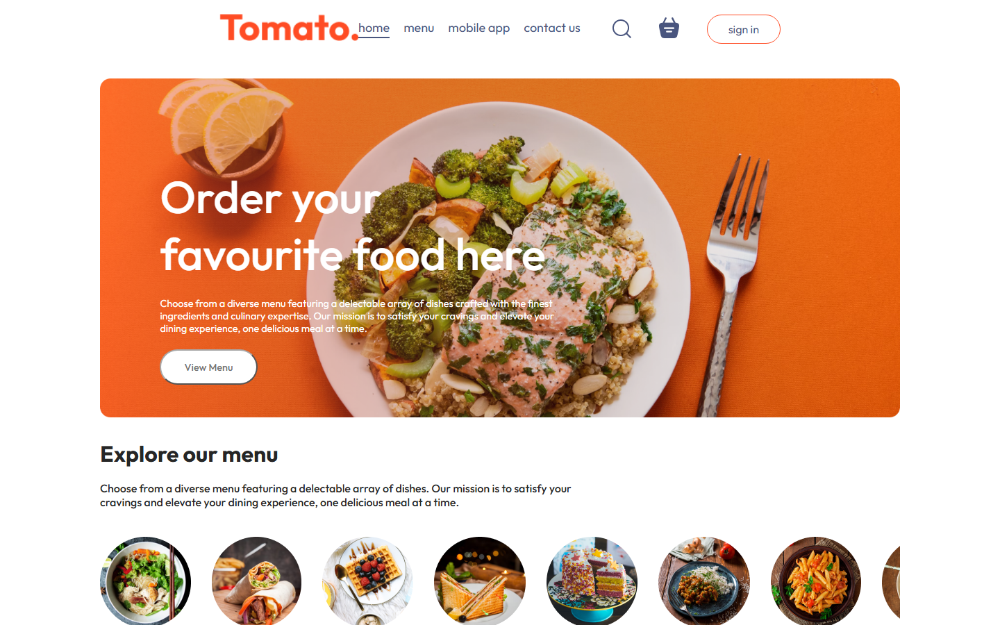
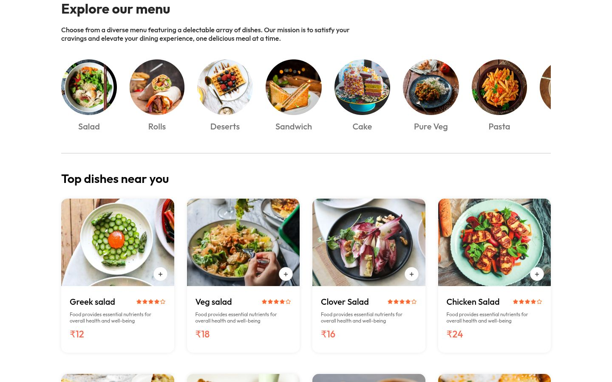
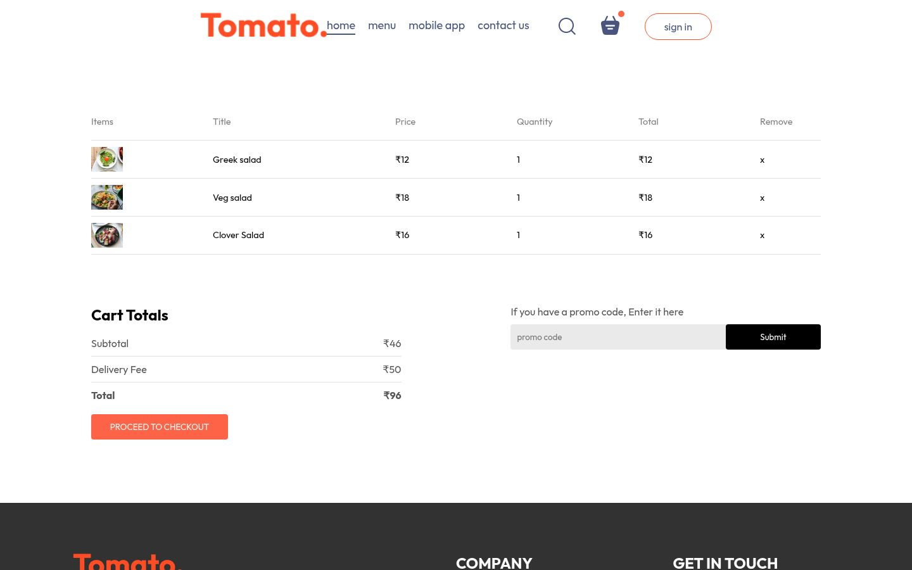
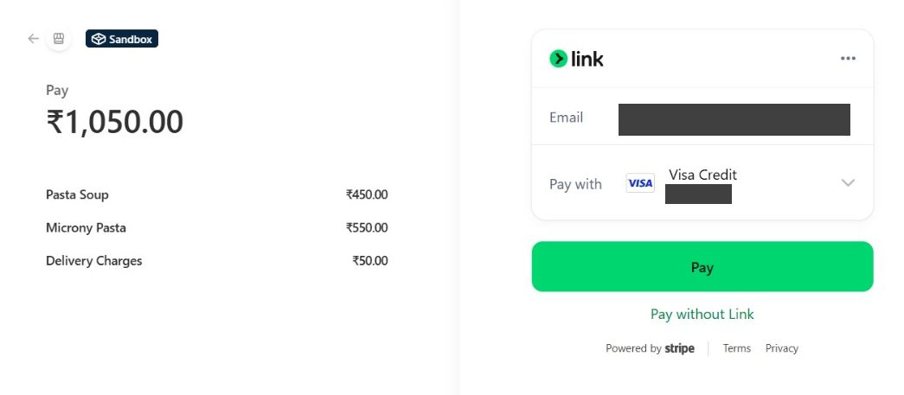
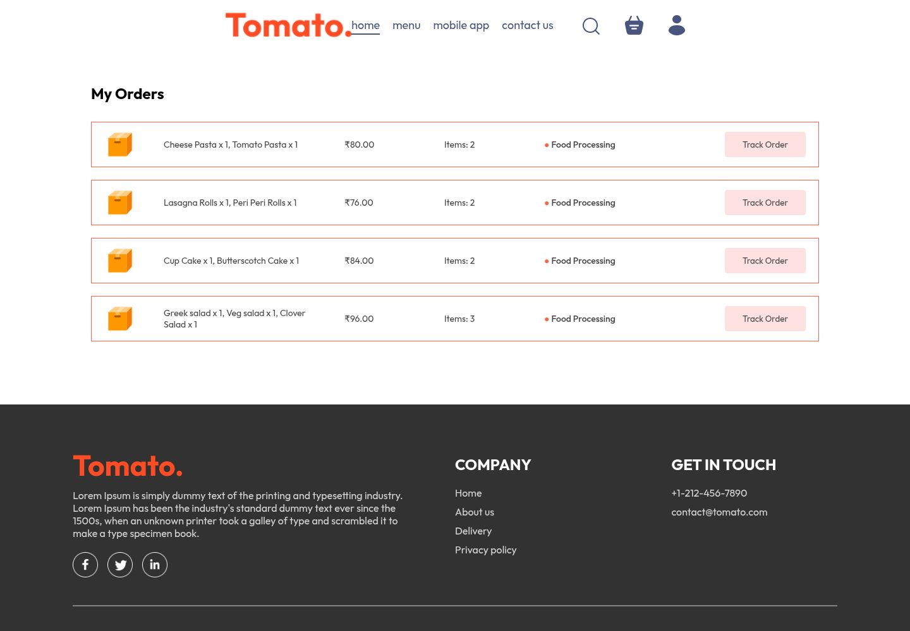
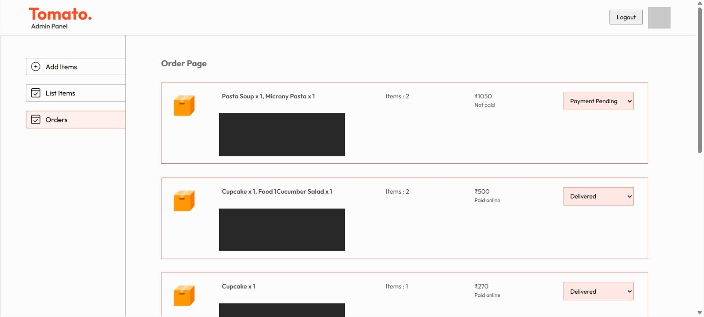
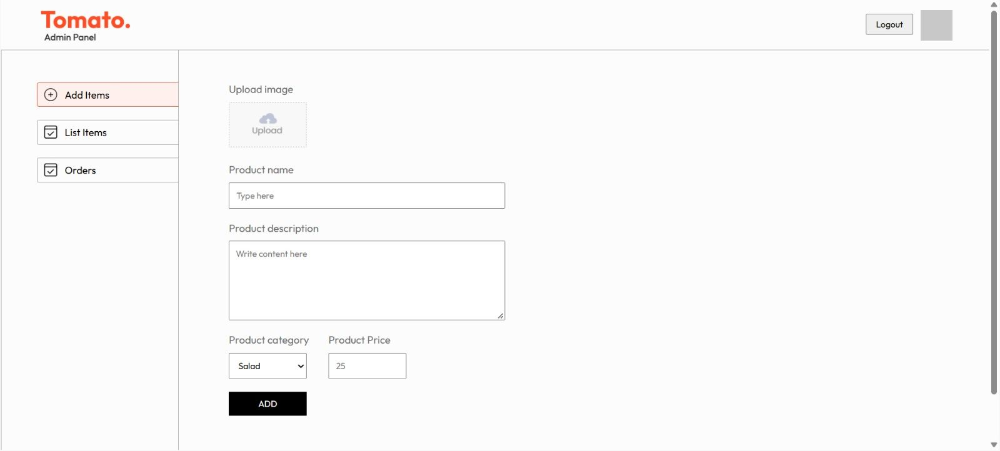
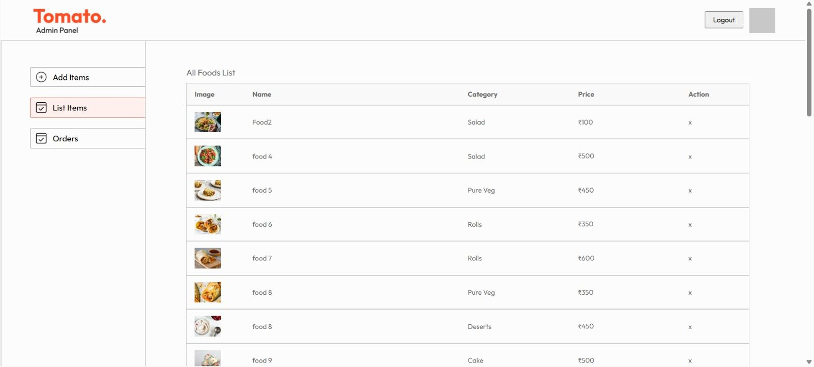

# 🍕 Full Stack Food Delivery Application

A full-stack food delivery web application built using **React.js, Node.js, Express.js, MongoDB, and JWT authentication**. The application provides a complete food ordering experience for customers along with an admin panel for managing food items and orders. It is being split into services: a Spring Boot **gateway**, a Spring Boot **order-service** and a Spring Boot **inventory-service** (each with its own PostgreSQL database) run next to the Node.js backend, all started with Docker Compose.

##  Project Overview

This project is designed to provide a complete food ordering platform where users can:

- Browse food items and categories
- Search and explore food products
- Add food items to the cart
- Manage cart items and quantities
- Place food orders
- Complete the payment process
- View and track their orders
- Register and log in securely
- Access their profile and order history

The project also includes a separate **Admin Panel** for managing food items and orders.

---

## ✨ Key Features

### 👤 User Features

- User registration and login
- JWT-based authentication
- Browse food items
- Explore food categories
- Search and filter food items
- Add/remove items from cart
- Update item quantities
- Place orders
- Payment integration
- Order verification
- View previous orders
- User profile and logout functionality

### 🛠️ Admin Panel

- Admin dashboard
- Add new food items
- View food items
- Manage food items
- View customer orders
- Update order status
- Manage stock levels (track a food, set its units, stop tracking)
- Upload food images

### 🔐 Authentication & Security

- JWT-based authentication
- Protected backend routes
- Authentication middleware
- Secure user session handling
- Environment variables for sensitive configuration

---

## 🛠️ Technologies Used

### Frontend

- React.js
- JavaScript (ES6+)
- HTML5
- CSS3
- Vite
- React Router
- Context API
- Axios

### Backend

- Node.js
- Express.js
- REST APIs
- JWT
- Middleware
- Mongoose

### Services

- Spring Boot API gateway (verifies the JWT and forwards requests)
- Spring Boot order-service and inventory-service (Java 17, Spring Data JPA, Flyway)

### Database

- MongoDB (Atlas) for users, foods and carts
- PostgreSQL 16 for orders (order-service) and a separate PostgreSQL 16 for stock (inventory-service)

### Payment

- Stripe

### Development Tools

- Git
- GitHub
- VS Code
- Postman
- npm
- Docker and Docker Compose

---

## 📂 Project Structure

```text
food-delivery-fullstack/
│
├── admin/
│   ├── public/
│   ├── src/
│   │   ├── components/
│   │   ├── pages/
│   │   └── assets/
│   ├── package.json
│   └── vite.config.js
│
├── backend/
│   ├── config/
│   ├── controllers/
│   ├── middleware/
│   ├── models/
│   ├── routes/
│   ├── uploads/
│   ├── Dockerfile
│   ├── package.json
│   └── server.js
│
├── gateway/                 # Spring Boot API gateway
│   ├── src/
│   ├── pom.xml
│   └── Dockerfile
│
├── order-service/           # Spring Boot order service + PostgreSQL
├── inventory-service/       # Spring Boot stock service + its own PostgreSQL
│   ├── src/
│   ├── pom.xml
│   └── Dockerfile
│
├── smallapp/
│   ├── public/
│   ├── src/
│   │   ├── assets/
│   │   ├── components/
│   │   ├── context/
│   │   └── pages/
│   ├── package.json
│   └── vite.config.js
│
├── docker-compose.yml
├── start-dev.bat            # Windows: start everything for local development
├── .gitignore
└── README.md
```

---

## ⚙️ Installation & Setup

### 1. Clone the Repository

```bash
git clone https://github.com/tasleemk17/food-delivery-fullstack.git
```

Navigate to the project:

```bash
cd food-delivery-fullstack
```

### Quick start on Windows

After the `backend/.env` file exists (see [Environment Variables](#-environment-variables)), one command starts the Docker services, the customer app and the admin panel:

```bash
start-dev.bat
```

Add `stripe` to also start the Stripe webhook forwarder: `start-dev.bat stripe`. The sections below explain each part step by step.

---

## 🐳 Run Everything with Docker

Docker Compose starts eight containers: the Node.js backend, the gateway, the order-service, the inventory-service, two PostgreSQL databases and the two React apps (built with Vite and served by nginx).

| Service | Container | URL |
|---|---|---|
| Customer app | `food-smallapp` | http://localhost:5173 |
| Admin panel | `food-admin` | http://localhost:5174 |
| Node.js backend | `food-backend` | http://localhost:4000 |
| Gateway | `food-gateway` | http://localhost:8090 |
| order-service | `food-order-service` | internal only, reached through the gateway at `/api/order/**` |
| inventory-service | `food-inventory-service` | internal only, reached through the gateway at `/api/inventory/**` |
| PostgreSQL (orders) | `food-postgres` | internal only, no published port |
| PostgreSQL (stock) | `food-postgres-inventory` | internal only, no published port |

The React apps call the gateway at `http://localhost:8090`. This address is set at build time with the `VITE_API_URL` build argument in `docker-compose.yml`, because the browser, not the container, makes the requests. Ports 5173 and 5174 are fixed because the backend and gateway only allow those two origins (CORS).

If you change the React code, run `docker compose up -d --build` again to rebuild the apps. For hot reload while editing, use `start-dev.bat` or run `npm run dev` yourself; stop the React containers first with `docker compose stop smallapp admin`, because they use the same ports.

### Requirements

- Docker Desktop, running
- A `backend/.env` file (see [Environment Variables](#-environment-variables)). The backend and the gateway both read it.
- An internet connection, because MongoDB stays on Atlas

### Start

```bash
docker compose up -d --build
```

The first build takes a few minutes because Maven downloads the order-service dependencies. Later builds use the cache and take seconds. If the code has not changed, `docker compose up -d` is enough.

### Check that everything is running

```bash
docker compose ps
```

All services should show `Up`, and `food-backend` and `food-postgres` should show `healthy`. Gateway health endpoint: http://localhost:8090/actuator/health

The gateway sends `/api/order/**` to order-service (orders, payments, Stripe webhook) and everything else to the Node backend. order-service has no published port, so it is only reachable through the gateway.

### Stripe webhook (local testing)

Stripe tells the server that a payment succeeded by calling a webhook. On your laptop, the Stripe CLI forwards those calls to the gateway. Keep this running in its own terminal while you test payments:

```bash
stripe listen --events checkout.session.completed,checkout.session.expired --forward-to localhost:8090/api/order/webhook
```

1. The command prints a signing secret that starts with `whsec_`.
2. Put it in `backend/.env` as `STRIPE_WEBHOOK_SECRET`. Do not share it or commit it.
3. Restart order-service so it reads the new value:

```bash
docker compose up -d --force-recreate order-service
```

Without `stripe listen` running, a Stripe order stays unpaid. For a test payment use card `4242 4242 4242 4242` with any future expiry date and any CVC.

### Logs

```bash
docker compose logs -f order-service
```

Replace `order-service` with `backend`, `gateway` or `postgres` to see another service.

### Stop

```bash
docker compose down
```

Order data lives in the `orders-data` Docker volume, so it survives `docker compose down`. Do **not** add `-v` unless you want to delete the PostgreSQL data too.

### Database password

The PostgreSQL password defaults to a local development value. To change it, create a `.env` file in the project root:

```env
ORDERS_DB_PASSWORD=your_password
```

---

## 🧾 Order Service

`order-service` is a Spring Boot (Java 17) service that stores orders in PostgreSQL. Database tables are created by Flyway migrations (`order-service/src/main/resources/db/migration`).

- Read endpoints: a user's orders and the admin order list
- Command endpoints: placing orders and payments
- It reads cart and food data from the Node backend through an internal API protected by `INTERNAL_API_KEY`
- It trusts the `X-User-Id` header, so it must only be reachable through the gateway. That is why `docker-compose.yml` does not publish its port.
- New orders are stored in PostgreSQL. Orders created before this change stay in MongoDB and are not shown in "My Orders" or the admin order list.

To look at the orders in the database:

```bash
docker exec food-postgres psql -U orders -d orders -c "select id, payment_method, paid, status, amount, created_at from orders order by created_at desc limit 5;"
```

### Run the tests

```bash
cd order-service
./mvnw test
```

Some tests use Testcontainers, so Docker must be running.

### Configuration

| Variable | Used by | Purpose |
|---|---|---|
| `DB_URL`, `DB_USER`, `DB_PASSWORD` | order-service | PostgreSQL connection |
| `NODE_BASE_URL` | order-service | Address of the Node backend |
| `INTERNAL_API_KEY` | backend, order-service | Shared key for internal endpoints |
| `STRIPE_SECRET_KEY`, `STRIPE_WEBHOOK_SECRET` | order-service | Stripe payments |
| `INVENTORY_BASE_URL` | order-service | Address of inventory-service (stock reservations) |
| `NODE_BACKEND_URL` | gateway | Where the gateway forwards requests |
| `ORDER_SERVICE_URL`, `INVENTORY_SERVICE_URL` | gateway | Where the gateway sends `/api/order/**` and `/api/inventory/**` |

---

## 📦 Inventory Service

`inventory-service` is a Spring Boot (Java 17) service that keeps stock levels in its own PostgreSQL database. Tables are created by Flyway migrations (`inventory-service/src/main/resources/db/migration`).

- **Opt-in tracking:** a food with no stock row is "not tracked" and is always available. Setting a stock level for a food starts tracking it, so existing foods keep working.
- **Reservations:** an order holds stock with `POST /internal/inventory/reservations`. It is all or nothing: if one food is short, no stock is taken and the answer is `409` with the food id and how many are left. The reservation is later committed (paid) or released (payment failed or expired), and the stock goes back exactly once.
- **Safe under load:** stock is taken with one atomic SQL update (`quantity >= :qty`), and the database `CHECK (quantity >= 0)` is the last line of defence. A test starts 10 orders at the same time for 3 units and expects exactly 3 to win.
- **Idempotent:** every call is keyed by the order id, so a retry never takes or returns stock twice.
- **Admin API (through the gateway, admin only):** `GET /api/inventory` lists stock, `PUT /api/inventory/{foodId}` with `{"quantity": 10}` sets it, and `DELETE /api/inventory/{foodId}` stops tracking the food (it is always available again).
- **Admin panel:** the **Stock** page lists every food with a status badge (not tracked, in stock, low, out of stock), a field to type the units, and Save / Stop tracking buttons.
- **Public API:** `GET /api/inventory/availability` returns `{ foodId: true/false }` for the menu, without exposing quantities.
- **Customer menu:** a food with no units left shows a grey picture and an "Out of stock" badge and cannot be added. If it is already in the cart, the cart marks it and it can be removed. The menu looks again when the browser tab is shown, and checkout still checks the stock on the server.
- **Internal API:** `/internal/**` needs the shared `X-Internal-Key` (`INTERNAL_API_KEY`), and the gateway never routes it from outside.

### How orders use it

1. **Placing an order:** order-service reserves the stock first. If a food is short, the customer gets `409` with a clear message ("Salad is out of stock" or "Only 1 left of Salad"), no order is saved, and the cart is kept so it can be fixed.
2. **Paid:** when Stripe confirms payment (webhook or the return page), the reservation is committed. Cash on delivery is committed straight away.
3. **Payment failed or expired:** the reservation is released and the stock goes back. Stripe sessions last 35 minutes, so unpaid orders do not hold stock for long.
4. **If inventory-service is down**, placing an order fails with `503` and nothing is saved, so stock can never be oversold.

Commit and release only change the reservation's label, so a failure there is logged and never fails an order.

---

## 🔧 Backend Setup

To run the Node.js backend without Docker:

Navigate to the backend:

```bash
cd backend
```

Install dependencies:

```bash
npm install
```

Create a `.env` file inside the `backend` folder.

Example:

```env
MONGODB_URI=your_mongodb_connection_string
JWT_SECRET=your_jwt_secret
INTERNAL_API_KEY=your_internal_api_key
STRIPE_SECRET_KEY=your_stripe_secret_key
STRIPE_WEBHOOK_SECRET=your_stripe_webhook_secret
```

> **Note:** Never commit your `.env` file or API credentials to GitHub.

Start the backend server:

```bash
npm start
```

---

## 💻 Frontend Setup

The React apps start automatically with `docker compose up -d --build`. This section is for running them with hot reload during development (stop the containers first: `docker compose stop smallapp admin`).

Open a new terminal and navigate to:

```bash
cd smallapp
```

Install dependencies:

```bash
npm install
```

Start the development server:

```bash
npm run dev
```

The customer app runs at http://localhost:5173 and calls the gateway on port 8090.

---

## 🛠️ Admin Panel Setup

Open another terminal:

```bash
cd admin
```

Install dependencies:

```bash
npm install
```

Start the admin application:

```bash
npm run dev
```

The admin panel runs at http://localhost:5174.

### Create an admin account

There is no fixed admin password. An admin is a normal user that has been promoted:

1. Sign up on the customer app (http://localhost:5173).
2. Promote that email:

```bash
cd backend
npm run make-admin -- you@example.com
```

3. Log in to the admin panel with the same email and password. If you were already logged in, log out and log in again to get a new token.

---

## 🔄 Application Flow

```text
User
  │
  ▼
React Frontend
  │
  ▼
Gateway (verifies JWT)
  │
  ├──────────────► Node.js + Express.js ──► MongoDB
  │
  └──────────────► order-service ─────────► PostgreSQL
```

For authentication:

```text
User Login
    │
    ▼
Backend Authentication
    │
    ▼
JWT Token
    │
    ▼
Protected Routes
```

---

##  Main Modules

### Customer Application

The customer-facing application provides the complete food ordering workflow:

```text
Home
  ↓
Explore Food
  ↓
Food Details
  ↓
Add to Cart
  ↓
Cart
  ↓
Place Order
  ↓
Payment
  ↓
Order Verification
  ↓
My Orders
```

### Admin Application

```text
Admin Login
    ↓
Dashboard
    ↓
Add Food
    ↓
Food List
    ↓
Orders
    ↓
Update Order Status
```

---

## 🔑 Environment Variables

For security, sensitive credentials are stored in environment variables.

The `.env` file is intentionally excluded from Git using `.gitignore`.

Example (`backend/.env`):

```env
MONGODB_URI=your_mongodb_uri
JWT_SECRET=your_secret_key
INTERNAL_API_KEY=your_internal_api_key
STRIPE_SECRET_KEY=your_stripe_secret_key
STRIPE_WEBHOOK_SECRET=your_stripe_webhook_secret
```

Replace the placeholder values with your own credentials.

---

## 🔐 Security Improvements

I improved the security of the application by adding proper JWT authentication and authorization.

User identity is taken from the verified token instead of trusting user details sent from the frontend.

I also added validation for orders, addresses, payment details, and admin actions to prevent invalid or unauthorized requests.

Stripe payments are verified on the backend before marking an order as paid.

---

## 📸 Screenshots

### Customer Application

**Home page**



**Menu: categories and top dishes**



**Cart**



**Payment** (Stripe Checkout in test mode)



**My Orders** (orders are stored by order-service in PostgreSQL)



### Admin Panel

**Orders** (the admin changes the delivery status; customer details are hidden in this screenshot)



**Add a food item**



**Food list**



---

## 🎯 What I Worked On

I worked on the development of the full-stack food delivery application, including:

- React.js frontend development
- Reusable React components
- Food listing and filtering functionality
- Cart management
- User authentication
- JWT-based authorization
- REST API integration
- Node.js and Express.js backend development
- MongoDB database integration
- Order management
- Payment gateway integration
- Admin panel functionality
- Spring Boot gateway and order-service with PostgreSQL
- Docker Compose setup for the backend services
- API testing using Postman

---

## 💡 Project Highlights

- Full-stack web application with separate frontend, backend, and admin applications
- RESTful API architecture
- JWT-based authentication and protected routes
- MongoDB database integration using Mongoose
- Cart and order management
- Online payment integration
- Gateway and order-service microservices, run with Docker Compose
- Responsive React user interface
- Separate admin panel for application management

---

## 📚 Learning Outcomes

Through this project, I gained practical experience in:

- Building full-stack web applications
- Developing REST APIs
- Connecting React applications with backend services
- Working with MongoDB and Mongoose
- Working with PostgreSQL, Spring Boot and Docker
- Implementing authentication and authorization
- Managing application state with React
- Integrating third-party payment services
- Using Git and GitHub for version control
- Testing APIs using Postman

---

## 👩‍💻 Author

**Tasleem Kousar Inamdar**

MCA | Full Stack Developer

### Technologies

`React.js` `JavaScript` `Node.js` `Express.js` `MongoDB` `Mongoose` `PostgreSQL` `Spring Boot` `Docker` `JWT` `REST API` `Stripe` `Git` `GitHub`

---

## ⭐ If you find this project useful

Feel free to explore the repository and review the implementation.
