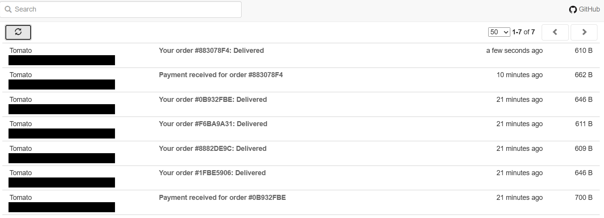
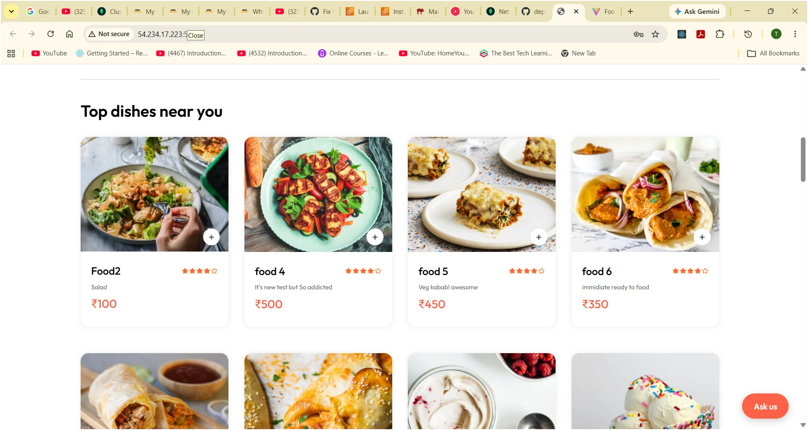
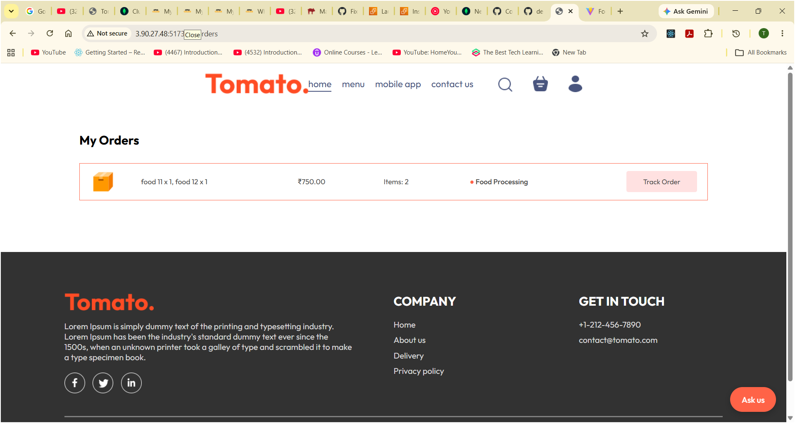
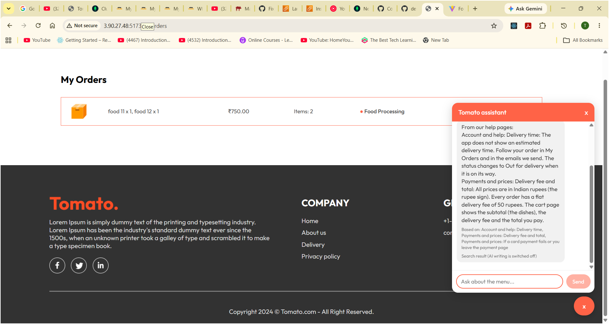
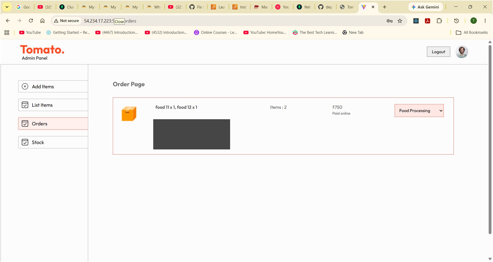
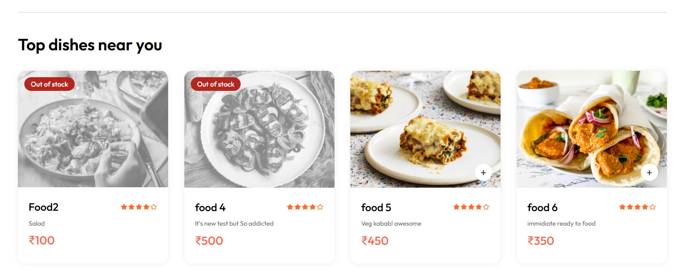
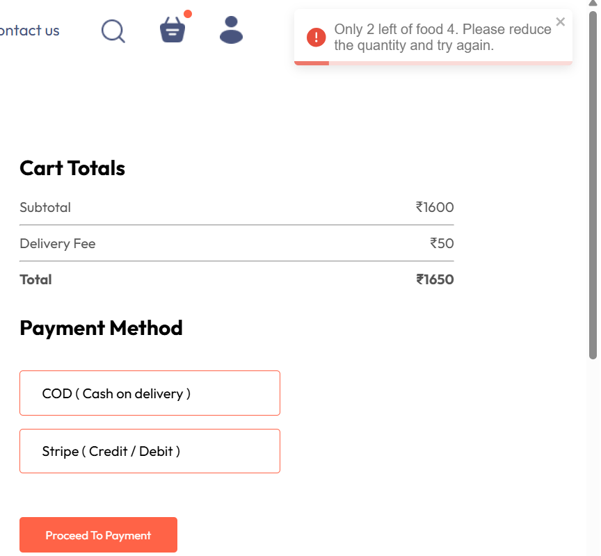

# 🍕 Full Stack Food Delivery Application

A full-stack food delivery web application built using **React.js, Node.js, Express.js, MongoDB, and JWT authentication**. The application provides a complete food ordering experience for customers along with an admin panel for managing food items and orders. It is being split into services: a Spring Boot **gateway**, a Spring Boot **order-service** and a Spring Boot **inventory-service** (each with its own PostgreSQL database) run next to the Node.js backend, all started with Docker Compose.

##  Project Overview

This project is designed to provide a complete food ordering platform where users can:

- Browse food items and categories
- Search and explore food products
- Add food items to the cart
- Manage cart items and quantities
- Place food orders
- Complete the payment process
- View and track their orders
- Register and log in securely
- Access their profile and order history

The project also includes a separate **Admin Panel** for managing food items and orders.

---

## ✨ Key Features

### 👤 User Features

- User registration and login
- JWT-based authentication
- Browse food items
- Explore food categories
- Search and filter food items
- Add/remove items from cart
- Update item quantities
- Place orders
- Payment integration
- Order verification
- View previous orders
- User profile and logout functionality

### 🛠️ Admin Panel

- Admin dashboard
- Add new food items
- View food items
- Manage food items
- View customer orders
- Update order status
- Manage stock levels (track a food, set its units, stop tracking)
- Upload food images

### 🔐 Authentication & Security

- JWT-based authentication
- Protected backend routes
- Authentication middleware
- Secure user session handling
- Environment variables for sensitive configuration

---

## 🛠️ Technologies Used

### Frontend

- React.js
- JavaScript (ES6+)
- HTML5
- CSS3
- Vite
- React Router
- Context API
- Axios

### Backend

- Node.js
- Express.js
- REST APIs
- JWT
- Middleware
- Mongoose

### Services

- Spring Boot API gateway (verifies the JWT and forwards requests)
- Spring Boot order-service, inventory-service and notification-service (Java 17, Spring Data JPA, Flyway)
- Python ai-service (FastAPI): recommendations and a menu chatbot that uses the Claude API

### Database

- MongoDB (Atlas) for users, foods and carts
- PostgreSQL 16, one database per service: orders, stock, notifications and AI (recommendation counts)

### Messaging

- Apache Kafka (KRaft mode) for order events, sent with the transactional outbox pattern
- MailHog as the test mailbox for emails during development

### Payment

- Stripe

### Development Tools

- Git
- GitHub
- VS Code
- Postman
- npm
- Docker and Docker Compose

---

## 📂 Project Structure

```text
food-delivery-fullstack/
│
├── admin/
│   ├── public/
│   ├── src/
│   │   ├── components/
│   │   ├── pages/
│   │   └── assets/
│   ├── package.json
│   └── vite.config.js
│
├── backend/
│   ├── config/
│   ├── controllers/
│   ├── middleware/
│   ├── models/
│   ├── routes/
│   ├── uploads/
│   ├── Dockerfile
│   ├── package.json
│   └── server.js
│
├── gateway/                 # Spring Boot API gateway
│   ├── src/
│   ├── pom.xml
│   └── Dockerfile
│
├── order-service/           # Spring Boot order service + PostgreSQL
├── inventory-service/       # Spring Boot stock service + its own PostgreSQL
├── notification-service/    # Spring Boot: reads order events from Kafka, sends emails
│   ├── src/
│   ├── pom.xml
│   └── Dockerfile
│
├── ai-service/              # FastAPI: recommendations + menu chatbot (RAG with Claude)
│   ├── app/
│   ├── tests/
│   └── Dockerfile
│
├── deploy/                  # AWS EC2 deployment: scripts, prod compose file, guide
├── e2e/                     # Playwright end-to-end tests (browser against the Docker stack)
│
├── smallapp/
│   ├── public/
│   ├── src/
│   │   ├── assets/
│   │   ├── components/
│   │   ├── context/
│   │   └── pages/
│   ├── package.json
│   └── vite.config.js
│
├── docker-compose.yml
├── start-dev.bat            # Windows: start everything for local development
├── .gitignore
└── README.md
```

---

## ⚙️ Installation & Setup

### 1. Clone the Repository

```bash
git clone https://github.com/tasleemk17/food-delivery-fullstack.git
```

Navigate to the project:

```bash
cd food-delivery-fullstack
```

### Quick start on Windows

After the `backend/.env` file exists (see [Environment Variables](#-environment-variables)), one command starts the Docker services, the customer app and the admin panel:

```bash
start-dev.bat
```

Add `stripe` to also start the Stripe webhook forwarder: `start-dev.bat stripe`. The sections below explain each part step by step.

---

## 🐳 Run Everything with Docker

Docker Compose starts fourteen containers: the Node.js backend, the gateway, the order-service, the inventory-service, the notification-service, the ai-service, Kafka, MailHog (a test mailbox), four PostgreSQL databases and the two React apps (built with Vite and served by nginx).

| Service | Container | URL |
|---|---|---|
| Customer app | `food-smallapp` | http://localhost:5173 |
| Admin panel | `food-admin` | http://localhost:5174 |
| Node.js backend | `food-backend` | http://localhost:4000 |
| Gateway | `food-gateway` | http://localhost:8090 |
| order-service | `food-order-service` | internal only, reached through the gateway at `/api/order/**` |
| inventory-service | `food-inventory-service` | internal only, reached through the gateway at `/api/inventory/**` |
| PostgreSQL (orders) | `food-postgres` | internal only, no published port |
| PostgreSQL (stock) | `food-postgres-inventory` | internal only, no published port |
| PostgreSQL (notifications) | `food-postgres-notifications` | internal only, no published port |
| PostgreSQL (AI) | `food-postgres-ai` | internal only, no published port |
| ai-service | `food-ai-service` | internal only, reached through the gateway at `/api/ai/**` |
| notification-service | `food-notification-service` | no API; listens to Kafka and sends emails |
| MailHog | `food-mailhog` | http://localhost:8025 (the test inbox for emails) |
| Kafka | `food-kafka` | internal only (`kafka:9092`), no published port |

The React apps call the gateway at `http://localhost:8090`. This address is set at build time with the `VITE_API_URL` build argument in `docker-compose.yml`, because the browser, not the container, makes the requests. Ports 5173 and 5174 are fixed because the backend and gateway only allow those two origins (CORS).

If you change the React code, run `docker compose up -d --build` again to rebuild the apps. For hot reload while editing, use `start-dev.bat` or run `npm run dev` yourself; stop the React containers first with `docker compose stop smallapp admin`, because they use the same ports.

### Requirements

- Docker Desktop, running
- A `backend/.env` file (see [Environment Variables](#-environment-variables)). The backend and the gateway both read it.
- An internet connection, because MongoDB stays on Atlas

### Start

```bash
docker compose up -d --build
```

The first build takes a few minutes because Maven downloads the order-service dependencies. Later builds use the cache and take seconds. If the code has not changed, `docker compose up -d` is enough.

### Check that everything is running

```bash
docker compose ps
```

All services should show `Up`, and `food-backend` and `food-postgres` should show `healthy`. Gateway health endpoint: http://localhost:8090/actuator/health

The gateway sends `/api/order/**` to order-service (orders, payments, Stripe webhook) and everything else to the Node backend. order-service has no published port, so it is only reachable through the gateway.

### Stripe webhook (local testing)

Stripe tells the server that a payment succeeded by calling a webhook. On your laptop, the Stripe CLI forwards those calls to the gateway. Keep this running in its own terminal while you test payments:

```bash
stripe listen --events checkout.session.completed,checkout.session.expired --forward-to localhost:8090/api/order/webhook
```

1. The command prints a signing secret that starts with `whsec_`.
2. Put it in `backend/.env` as `STRIPE_WEBHOOK_SECRET`. Do not share it or commit it.
3. Restart order-service so it reads the new value:

```bash
docker compose up -d --force-recreate order-service
```

Without `stripe listen` running, a Stripe order stays unpaid. For a test payment use card `4242 4242 4242 4242` with any future expiry date and any CVC.

### Logs

```bash
docker compose logs -f order-service
```

Replace `order-service` with `backend`, `gateway` or `postgres` to see another service.

### Stop

```bash
docker compose down
```

Order data lives in the `orders-data` Docker volume, so it survives `docker compose down`. Do **not** add `-v` unless you want to delete the PostgreSQL data too.

### Database password

The PostgreSQL password defaults to a local development value. To change it, create a `.env` file in the project root:

```env
ORDERS_DB_PASSWORD=your_password
```

---

## 🧾 Order Service

`order-service` is a Spring Boot (Java 17) service that stores orders in PostgreSQL. Database tables are created by Flyway migrations (`order-service/src/main/resources/db/migration`).

- Read endpoints: a user's orders and the admin order list
- Command endpoints: placing orders and payments
- It reads cart and food data from the Node backend through an internal API protected by `INTERNAL_API_KEY`
- It trusts the `X-User-Id` header, so it must only be reachable through the gateway. That is why `docker-compose.yml` does not publish its port.
- New orders are stored in PostgreSQL. Orders created before this change stay in MongoDB and are not shown in "My Orders" or the admin order list.

To look at the orders in the database:

```bash
docker exec food-postgres psql -U orders -d orders -c "select id, payment_method, paid, status, amount, created_at from orders order by created_at desc limit 5;"
```

### Run the tests

```bash
cd order-service
./mvnw test
```

Some tests use Testcontainers, so Docker must be running.

### Configuration

| Variable | Used by | Purpose |
|---|---|---|
| `DB_URL`, `DB_USER`, `DB_PASSWORD` | order-service | PostgreSQL connection |
| `NODE_BASE_URL` | order-service | Address of the Node backend |
| `INTERNAL_API_KEY` | backend, order-service | Shared key for internal endpoints |
| `STRIPE_SECRET_KEY`, `STRIPE_WEBHOOK_SECRET` | order-service | Stripe payments |
| `INVENTORY_BASE_URL` | order-service | Address of inventory-service (stock reservations) |
| `KAFKA_BOOTSTRAP_SERVERS` | order-service, inventory-service, notification-service | Where Kafka is (`kafka:9092` in Docker) |
| `MAIL_HOST`, `MAIL_PORT` | notification-service | The SMTP server for emails (`mailhog`, `1025` in Docker) |
| `NODE_BACKEND_URL` | gateway | Where the gateway forwards requests |
| `ORDER_SERVICE_URL`, `INVENTORY_SERVICE_URL` | gateway | Where the gateway sends `/api/order/**` and `/api/inventory/**` |

---

## 📦 Inventory Service

`inventory-service` is a Spring Boot (Java 17) service that keeps stock levels in its own PostgreSQL database. Tables are created by Flyway migrations (`inventory-service/src/main/resources/db/migration`).

- **Opt-in tracking:** a food with no stock row is "not tracked" and is always available. Setting a stock level for a food starts tracking it, so existing foods keep working.
- **Reservations:** an order holds stock with `POST /internal/inventory/reservations`. It is all or nothing: if one food is short, no stock is taken and the answer is `409` with the food id and how many are left. The reservation is later committed (paid) or released (payment failed or expired), and the stock goes back exactly once.
- **Safe under load:** stock is taken with one atomic SQL update (`quantity >= :qty`), and the database `CHECK (quantity >= 0)` is the last line of defence. A test starts 10 orders at the same time for 3 units and expects exactly 3 to win.
- **Idempotent:** every call is keyed by the order id, so a retry never takes or returns stock twice.
- **Admin API (through the gateway, admin only):** `GET /api/inventory` lists stock, `PUT /api/inventory/{foodId}` with `{"quantity": 10}` sets it, and `DELETE /api/inventory/{foodId}` stops tracking the food (it is always available again).
- **Admin panel:** the **Stock** page lists every food with a status badge (not tracked, in stock, low, out of stock), a field to type the units, and Save / Stop tracking buttons.
- **Public API:** `GET /api/inventory/availability` returns `{ foodId: true/false }` for the menu, without exposing quantities.
- **Customer menu:** a food with no units left shows a grey picture and an "Out of stock" badge and cannot be added. If it is already in the cart, the cart marks it and it can be removed. The menu looks again when the browser tab is shown, and checkout still checks the stock on the server.
- **Internal API:** `/internal/**` needs the shared `X-Internal-Key` (`INTERNAL_API_KEY`), and the gateway never routes it from outside.

### How orders use it

1. **Placing an order (a direct call):** order-service reserves the stock first, because checkout needs the answer at once. If a food is short, the customer gets `409` with a clear message ("Salad is out of stock" or "Only 1 left of Salad"), no order is saved, and the cart is kept so it can be fixed. If inventory-service is down, placing an order fails with `503` and nothing is saved, so stock can never be oversold.
2. **Paid (an event):** order-service publishes `ORDER_PAID` (or `ORDER_PLACED` for cash on delivery) and inventory-service **commits** the reservation when it reads it.
3. **Payment failed or expired (an event):** order-service publishes `ORDER_PAYMENT_FAILED` and inventory-service **releases** the reservation, so the stock goes back. Stripe sessions last 35 minutes, so unpaid orders do not hold stock for long.

Steps 2 and 3 go through Kafka on purpose. If inventory-service is down or restarting at that moment, the event simply waits and is handled when it is back, so the stock can never end up wrong because of a short outage. (Before, a failed direct call was only logged.)

- **Safe to repeat:** commit and release can be applied twice with the same result, so it does not matter that Kafka may deliver an event twice or that the whole topic is read again. An order with no reservation (all its foods untracked) is simply left alone.
- **Contradictions are parked, not guessed:** for example a payment that arrives after the stock was already given back. Retrying cannot fix that and a person must decide, so the event goes to the dead letter topic `order-events.inventory.DLT` and an error is logged. The events behind it carry on.
- The one release order-service still does itself is when saving the order fails right after the stock was held. Then there is no order and so no event.

---

## 📨 Order Events (Kafka)

When an order changes, order-service publishes an event to the Kafka topic `order-events`, so other services can react without order-service calling them.

| Event | When |
|---|---|
| `ORDER_PLACED` | An order is saved (cash on delivery is confirmed at once; a Stripe order waits for payment) |
| `ORDER_PAID` | Stripe confirmed the payment |
| `ORDER_PAYMENT_FAILED` | The payment failed or the 35 minute Stripe session expired |
| `ORDER_STATUS_CHANGED` | An admin moved the order along (for example "Out for delivery") |

Each message is JSON with a unique `eventId` and everything a listener needs (order id, user, email, items, amount, status). It leaves out the street address and phone number. The Kafka key is the order id, so the events of one order always arrive in the order they happened, and a header `event-type` names the event.

**How it stays reliable (the outbox pattern)**

- The event is written to the `outbox_events` table in the **same database transaction** as the order change. Either both are saved or neither is, so an event is never missing for a change that happened, and never sent for one that was rolled back.
- A publisher sends the saved events to Kafka about once a second and marks each one sent only after Kafka confirms it (`acks=all`, idempotent producer). If it crashes in between, the event is sent again, so listeners must handle the same `eventId` twice.
- If Kafka is down, **orders keep working**. The events wait in the table, oldest first, and go out by themselves when Kafka is back.
- Only a real change makes an event: repeating a payment notification or choosing the status an order already has sends nothing.
- Amounts always have two decimals (`1350.00`), whether the order was just created or read back from the database.

**Who listens:** `notification-service` (emails the customer) and `inventory-service` (commits or releases the reserved stock). Each has its own consumer group, so each reads every event, and each has its own dead letter topic (`order-events.notification.DLT`, `order-events.inventory.DLT`).

To watch the events (Windows Command Prompt; in Git Bash put `MSYS_NO_PATHCONV=1` in front):

```bash
docker exec food-kafka /opt/kafka/bin/kafka-console-consumer.sh --bootstrap-server localhost:9092 --topic order-events --from-beginning --property print.key=true
```

## ✉️ Notifications (email)

`notification-service` listens to the `order-events` topic and emails the customer. It never calls order-service: everything it needs is inside the event.

| Event | Email |
|---|---|
| `ORDER_PLACED` (cash on delivery) | "Order confirmed" |
| `ORDER_PLACED` (Stripe) | none, the customer is still paying |
| `ORDER_PAID` | "Payment received" |
| `ORDER_PAYMENT_FAILED` | "Payment failed" (says the cart is still saved) |
| `ORDER_STATUS_CHANGED` | "Your order is Out for delivery" / "Delivered" |



**Nothing real is sent while developing.** In Docker the emails go to **MailHog**, a fake mail server with a web inbox. Open http://localhost:8025 to read them. To send real emails, point `MAIL_HOST` and `MAIL_PORT` (and, for a provider that needs it, the `spring.mail.*` login settings) at a real SMTP server.

**What it guarantees**

- **Each event sends at most one email.** Kafka may deliver a message twice, so every email is recorded with its unique `eventId` in the service's own database, and a repeated event is recognised and ignored.
- **A failed email is not lost.** The record and the sending happen in one transaction. If the mail server is down, the record is rolled back and the message is retried after 1 s, 2 s, 4 s ... (at most 30 s apart, 8 times).
- **A broken message cannot block the others.** A message that is not a valid event goes straight to the dead letter topic `order-events.notification.DLT`, and so does one that still fails after the retries. The service carries on with the next event.
- **A new service catches up.** It starts reading from the beginning of the topic, so events that arrived while it was down are not missed. Kafka remembers how far it has read, so a restart sends nothing twice.
- **New event types do no harm.** Unknown event types and unknown fields are ignored.

---

## 🤖 AI Service

`ai-service` is a small Python (FastAPI) service with two features. Like the notification-service, it never calls order-service: it learns from the order events.

### 1. "Customers also ordered" (recommendations)

The service reads the `order-events` topic and counts, for every dish, in how many **confirmed** orders it appeared and which dishes appeared together (a paid Stripe order, or a cash on delivery order). A quantity does not matter: "2 x pasta" counts once. It has its own consumer group `ai-service`, its own database and its own dead letter topic `order-events.ai.DLT`, and it starts reading from the beginning of the topic, so a new database learns from the whole history.

| Endpoint | Who | What |
|---|---|---|
| `GET /api/ai/recommendations?foodIds=a,b&limit=4` | everyone | Dishes most often ordered with the given ones (for example the cart). Topped up with the popular dishes. |
| `GET /api/ai/recommendations/popular?limit=4` | everyone | The most ordered dishes |
| `POST /api/ai/chat` | logged in | The chatbot (below) |

Dishes that are sold out or no longer on the menu are never recommended. Counting is safe to repeat: every event id is saved in the same transaction as the counts, so a message that Kafka delivers twice is counted once.

### 2. The chatbot (RAG)

RAG means *retrieval-augmented generation*: the answer is written from real documents that were looked up first, not from what the model remembers.

```
question -> BM25 search over the menu and the help articles -> relevant text + question -> Claude -> answer + sources
```

- **The data is live.** The menu comes from the Node backend and the stock from inventory-service (both public endpoints, cached for 30 s). Sold out dishes are marked in the prompt, so the bot does not offer them.
- **The help articles** are markdown files in `ai-service/app/help_articles/`, cut into pieces at their headings. Edit them and restart to change what the bot knows.
- **Search** is BM25, written out in `app/search.py` (about 40 lines). It needs no model download and handles English, Hinglish and Hindi words. A small menu (up to 80 dishes) is put in the prompt completely; a bigger one is searched and only the best matches are sent.
- **Every answer lists its sources** (which dishes and help pages were used).
- **The bot only answers from the context.** If the answer is not there it says so. It cannot place orders or see anyone's orders. The question is wrapped in tags and cannot close them, and the system prompt tells Claude to treat it as data.

**Works without a key.** Without `ANTHROPIC_API_KEY` the chat still works but answers from search only (matching dishes and help text, `"mode": "search"`). If Claude is configured but fails (network, rate limit, a refusal), the same search answer is returned with `"degraded": true`. The chat never shows an error because Claude is down.

**To turn on Claude**, put the key in a `.env` file in the project root (next to `docker-compose.yml`; it is git ignored) and rebuild:

```bash
echo ANTHROPIC_API_KEY=your-key-here > .env
docker compose up -d --build ai-service
```

`ANTHROPIC_MODEL` chooses the model (default `claude-opus-5-5`). A chat answer is short, so a smaller model such as `claude-haiku-5-5` is much cheaper and fast enough; set it in the same `.env` file. The service uses the official `anthropic` SDK with low reasoning effort.

**Cost control:** a message is limited to 500 characters, only the last 6 turns are sent, and each user may send 20 messages per 10 minutes (`429` after that).

### In the customer app

- **Chat widget:** the "Ask us" button at the bottom right of every page opens the assistant. A visitor who is not logged in is asked to sign in first. The last answers are sent as history, so follow-up questions work, and each answer shows which dishes or help pages it was based on. When Claude is switched off, the answer is marked as a search result.
- **Customers also ordered:** the cart page shows up to four dishes that other customers ordered together with the dishes in the cart, each with an Add button. Nothing is shown when there is no history yet or the service is down.

### Configuration

| Variable | Default | Meaning |
|---|---|---|
| `DATABASE_URL` | local Postgres | The service's own database |
| `KAFKA_BOOTSTRAP_SERVERS` | `localhost:9092` | Where Kafka is (`kafka:9092` in Docker) |
| `KAFKA_ENABLED` | `true` | `false` turns the event listener off |
| `CATALOG_URL`, `INVENTORY_URL` | local | Where the menu and the stock come from |
| `ANTHROPIC_API_KEY` | empty | Empty = search-only chat |
| `ANTHROPIC_MODEL` | `claude-opus-5-5` | Which Claude model writes the answers |
| `CHAT_RATE_LIMIT_MESSAGES`, `CHAT_RATE_LIMIT_WINDOW_SECONDS` | `20`, `600` | Messages per user per window |

### Run the tests

```bash
cd ai-service
python -m venv .venv
.venv/Scripts/python -m pip install -r requirements-dev.txt   # Linux/macOS: .venv/bin/python
.venv/Scripts/python -m pytest
```

The tests start a real PostgreSQL with Testcontainers (Docker must be running). Claude is never called: a stand-in is used, so no API key and no cost.

---

## 🎭 End-to-End Tests

The unit and integration tests of each service run in CI. The `e2e` folder adds tests that drive a **real browser** against the whole running stack, so they prove that the services work together: website, gateway, Node backend, order-service, Kafka, notification-service, ai-service and MailHog.

| Test | What it proves |
|---|---|
| Menu loads | the website reads the menu through the gateway |
| Chat asks for a login | a visitor who is not logged in cannot chat |
| Sign up, order (COD), My Orders | the full customer flow, and that the confirmation email reached MailHog (order -> Kafka -> notification-service) |
| Cart suggestions | "Customers also ordered" appears and its Add button works |
| Assistant answer | a logged in customer gets an answer with sources |
| Wrong password | an error message is shown and the visitor stays logged out |
| Gateway security (5 tests) | public routes open, private routes need a login, a forged token is rejected, admin and `/internal` routes are closed |

```bash
docker compose up -d --build        # the stack must be running
cd e2e
npm install
npm test
```

On Windows the tests use the Microsoft Edge that is already installed, so nothing is downloaded. On Linux or macOS run `npx playwright install chromium` once first. To choose another browser: `E2E_BROWSER_CHANNEL=chrome npm test` (Windows PowerShell: `$env:E2E_BROWSER_CHANNEL="chrome"; npm test`). `npm run report` opens the HTML report; a failed test keeps a screenshot and a trace.

**Good to know**
- Each run signs up one new customer (`e2e.<number>@tomato.test`, a random password) and places one cash on delivery order. They stay in the database: the app has no way to delete them. Admins can recognise the orders by that address.
- The tests are **not in the CI workflow**: they need the whole stack, including MongoDB Atlas, so they run on your machine (later, against a test environment).
- The chat test accepts both answer styles (Claude or search-only), so it passes with or without `ANTHROPIC_API_KEY`.

---

## ☁️ Deploying to AWS

The whole stack runs on one EC2 server with Docker Compose (MongoDB stays on Atlas). The folder `deploy/` has a server setup script, `deploy.sh` (update, start, health checks), a production compose file and a step by step guide, and the manual GitHub Actions workflow **Deploy** updates the server over SSH. It is meant for a demo with Stripe test keys: the server is started when needed and terminated afterwards, so it costs a few dollars, not a monthly bill.

See **[deploy/README.md](deploy/README.md)** for the steps, the security group, the cost and how to stop paying.

### Running on AWS

The same stack, deployed on an EC2 server (Ubuntu 24.04, Docker Compose, 14 containers). The address bar shows the server's public IP address. The server is only started for demos, so the link is not always online.

**Customer app: menu**



**Customer app: an order placed on the server** (cash on delivery, saved by the order-service in its PostgreSQL database)



**Menu assistant** (no `ANTHROPIC_API_KEY` on this server, so it answers from search and says so at the bottom)



**Admin panel** (reachable only from the owner's IP address; customer details are hidden in this screenshot)



---

## 🔧 Backend Setup

To run the Node.js backend without Docker:

Navigate to the backend:

```bash
cd backend
```

Install dependencies:

```bash
npm install
```

Create a `.env` file inside the `backend` folder.

Example:

```env
MONGODB_URI=your_mongodb_connection_string
JWT_SECRET=your_jwt_secret
INTERNAL_API_KEY=your_internal_api_key
STRIPE_SECRET_KEY=your_stripe_secret_key
STRIPE_WEBHOOK_SECRET=your_stripe_webhook_secret
```

> **Note:** Never commit your `.env` file or API credentials to GitHub.

Start the backend server:

```bash
npm start
```

---

## 💻 Frontend Setup

The React apps start automatically with `docker compose up -d --build`. This section is for running them with hot reload during development (stop the containers first: `docker compose stop smallapp admin`).

Open a new terminal and navigate to:

```bash
cd smallapp
```

Install dependencies:

```bash
npm install
```

Start the development server:

```bash
npm run dev
```

The customer app runs at http://localhost:5173 and calls the gateway on port 8090.

---

## 🛠️ Admin Panel Setup

Open another terminal:

```bash
cd admin
```

Install dependencies:

```bash
npm install
```

Start the admin application:

```bash
npm run dev
```

The admin panel runs at http://localhost:5174.

### Create an admin account

There is no fixed admin password. An admin is a normal user that has been promoted:

1. Sign up on the customer app (http://localhost:5173).
2. Promote that email:

```bash
cd backend
npm run make-admin -- you@example.com
```

3. Log in to the admin panel with the same email and password. If you were already logged in, log out and log in again to get a new token.

---

## 🔄 Application Flow

```text
User
  │
  ▼
React Frontend
  │
  ▼
Gateway (verifies JWT)
  │
  ├──────────────► Node.js + Express.js ──► MongoDB
  │
  └──────────────► order-service ─────────► PostgreSQL
```

For authentication:

```text
User Login
    │
    ▼
Backend Authentication
    │
    ▼
JWT Token
    │
    ▼
Protected Routes
```

---

##  Main Modules

### Customer Application

The customer-facing application provides the complete food ordering workflow:

```text
Home
  ↓
Explore Food
  ↓
Food Details
  ↓
Add to Cart
  ↓
Cart
  ↓
Place Order
  ↓
Payment
  ↓
Order Verification
  ↓
My Orders
```

### Admin Application

```text
Admin Login
    ↓
Dashboard
    ↓
Add Food
    ↓
Food List
    ↓
Orders
    ↓
Update Order Status
```

---

## 🔑 Environment Variables

For security, sensitive credentials are stored in environment variables.

The `.env` file is intentionally excluded from Git using `.gitignore`.

Example (`backend/.env`):

```env
MONGODB_URI=your_mongodb_uri
JWT_SECRET=your_secret_key
INTERNAL_API_KEY=your_internal_api_key
STRIPE_SECRET_KEY=your_stripe_secret_key
STRIPE_WEBHOOK_SECRET=your_stripe_webhook_secret
```

Replace the placeholder values with your own credentials.

---

## 🔐 Security Improvements

I improved the security of the application by adding proper JWT authentication and authorization.

User identity is taken from the verified token instead of trusting user details sent from the frontend.

I also added validation for orders, addresses, payment details, and admin actions to prevent invalid or unauthorized requests.

Stripe payments are verified on the backend before marking an order as paid.

---

## 📸 Screenshots

### Customer Application

**Home page**


**Menu: categories and top dishes**


**Out of stock** (a food with no units left is greyed out and cannot be added)



**Cart**


**Payment** (Stripe Checkout in test mode)


**Stock check at checkout** (order-service asks inventory-service to hold the stock first; the delivery form is left out of this screenshot)



**My Orders** (orders are stored by order-service in PostgreSQL)


### Admin Panel

**Orders** (the admin changes the delivery status; customer details are hidden in this screenshot)


**Add a food item**


**Food list**


---

## 🎯 What I Worked On

I worked on the development of the full-stack food delivery application, including:

- React.js frontend development
- Reusable React components
- Food listing and filtering functionality
- Cart management
- User authentication
- JWT-based authorization
- REST API integration
- Node.js and Express.js backend development
- MongoDB database integration
- Order management
- Payment gateway integration
- Admin panel functionality
- Spring Boot gateway and order-service with PostgreSQL
- Docker Compose setup for the backend services
- API testing using Postman

---

## 💡 Project Highlights

- Full-stack web application with separate frontend, backend, and admin applications
- RESTful API architecture
- JWT-based authentication and protected routes
- MongoDB database integration using Mongoose
- Cart and order management
- Online payment integration
- Gateway and order-service microservices, run with Docker Compose
- Responsive React user interface
- Separate admin panel for application management

---

## 📚 Learning Outcomes

Through this project, I gained practical experience in:

- Building full-stack web applications
- Developing REST APIs
- Connecting React applications with backend services
- Working with MongoDB and Mongoose
- Working with PostgreSQL, Spring Boot and Docker
- Implementing authentication and authorization
- Managing application state with React
- Integrating third-party payment services
- Using Git and GitHub for version control
- Testing APIs using Postman

---

## 👩‍💻 Author

**Tasleem Kousar Inamdar**

MCA | Full Stack Developer

### Technologies

`React.js` `JavaScript` `Node.js` `Express.js` `MongoDB` `Mongoose` `PostgreSQL` `Spring Boot` `Docker` `JWT` `REST API` `Stripe` `Git` `GitHub`

---

## ⭐ If you find this project useful

Feel free to explore the repository and review the implementation.
